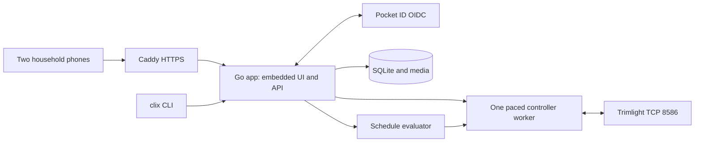

# Household lighting application

Living document. Rationale: [ADR-0003](../adr/0003-shared-homelab-application.md),
[ADR-0004](../adr/0004-pocket-id-and-truenas.md).
Pattern rationale: [ADR-0005](../adr/0005-versioned-household-patterns.md).
Calendar rationale: [ADR-0006](../adr/0006-explicit-calendar-intent.md).
Backup rationale: [ADR-0009](../adr/0009-consistent-portable-backups.md).
Backup contract: [backup and restore](../specs/backups.md).
Recovery procedure: [backup operations](backup-operations.md).
Photo rationale: [ADR-0008](../adr/0008-private-photos-and-physical-mapping.md).
Publication: [ADR-0007](../adr/0007-public-repository-and-private-deployment.md).
Image releases: [ADR-0015](../adr/0015-versioned-attested-images.md).
Contracts: [local service](../specs/local-service.md),
[household authentication](../specs/household-auth.md),
[house mapping](../specs/house.md), [pattern library](../specs/patterns.md), [calendar](../specs/schedules.md),
[draft v1 acceptance](../specs/v1-acceptance.md).

## Overview

Current: the clix CLI can read this controller's patterns and schedules. It has a
bounded write experiment, protocol fixtures, simulated-controller tests and a
container recipe. A loopback service persists observations and operation history
in SQLite, serializes explicit refresh requests, and requires a private API token.
Alternatively, household mode uses Pocket ID OIDC and serves the embedded React
UI. Initial screens show cached controller patterns, daily schedules and refresh
history. Authentication has simulated-provider coverage and confirmed desktop
Pocket ID sign-in and owner-confirmed phone passkey access. Second-user sign-in
and mobile task workflows remain open. The initial TrueNAS app and public Caddy HTTPS route
are deployed with controller access disabled; readiness, API authentication gates
and the OIDC redirect have passed integration checks.
Shared pattern editing, software strip previews, calendar editing and calendar
intent preview are implemented. House photo upload, manual mapping and software
previews are implemented under the house contract. A bounded diagnostic now verifies
OFF, saved-slot playback and TIMER restoration on the original controller. Authenticated native controls now use the existing worker, under
[ADR-0011](../adr/0011-audited-household-native-controls.md) and the
[native control contract](../specs/native-controls.md). Schedule execution and
physical calibration are not built.

The following is the accepted target, not a description of shipped components:



## Design

### Application boundaries

- `cmd/trimlight`: clix/Cobra command wiring only; flags are converted once into
  application configuration. Do not access clix's process-global flag variables
  inside concurrent HTTP handlers or workers.
- `internal/trimlight`: wire framing, typed controller models and capability checks.
- `internal/service`: bounded controller queue and authenticated HTTP API.
- `internal/storage`: SQLite schema and atomic observation/audit persistence. A
  process lock prevents concurrent owners of one data directory; separate data
  directories or hosts can still compete and require operational isolation.
- `internal/auth`: OIDC state/nonce/PKCE, subject allowlist, opaque sessions and CSRF.
- `internal/webui`: embedded browser build and restrictive content security policy.
  It serves `/`, `/assets/` and a fixed list of root files for home-screen use
  (`manifest.webmanifest`, `apple-touch-icon.png`, `icon-192.png`, `icon-512.png`).
- `internal/pattern`: validated design schema and deterministic logical-pixel render.
- `internal/schedule`: pure calendar validation, civil/solar intervals and precedence.
- `internal/house`: bounded photo normalization and validated address/geometry model.
  SQLite holds sanitized JPEG blobs and versioned layout references atomically.
- `web/`: compiled browser assets. Go embeds release assets; development may use
  a frontend dev server. No Node process is required in production.
- CLI commands proposed: `serve`, `status`, `doctor`, `patterns`, `schedules`,
  `layout`, `backup`, and `restore`. Keep the current snapshot/probe commands as
  explicit diagnostic operations during migration.

Implemented commands include `serve`, `status`, `refresh`, `snapshot`,
`probe-schedule2` and the separate `verify-playback` diagnostic. The service does not query hardware on startup or poll in the
background. Explicit refresh acknowledges possible clock synchronization and
uses a bounded queue, a 15-second operation deadline and one-second pacing between
operations. Failed reads preserve the last successful snapshot and record the
error. `status` reads cached storage only. Only verified native OFF/saved-slot/TIMER writes are available; other writes remain disabled.
Bearer-token development mode is loopback-only. OIDC mode supports container
binding with a fixed external HTTPS origin. These modes cannot be combined.
The UI polls cached status every five seconds while visible; this does not poll
hardware. CLI status/refresh currently support only local bearer mode; household
CLI login remains to be implemented.

The household UI leads with everyday actions: play a pattern, turn off, follow
light timers, plan routines and preview a roofline. As of 2026-10-29, Home puts
controls first and shows observation age as “Last checked.” Saved timer times use
the browser's local display format. The UI translates mode and operation names
into household language; raw snapshots, wire parameters, revision numbers and
transport errors remain in the service/API contracts rather than ordinary screens.
Calendar has one plain planning-only notice, with timer imports, file management,
history and setup behind disclosures. House keeps wiring and precise corner fields
behind setup controls. Preview labels state what the image is; research caveats
belong in this documentation. Clock-update acknowledgement, duplicate-submission
guards, stale-edit protection, authentication and production activation gates stay
in place. Panels use consistent inner spacing and controls wrap at phone widths.

As of 2026-10-30, the top-level page is in the URL hash (`#home`, `#library`,
`#calendar`, `#house`, `#settings`), so reload keeps the page and browser Back,
including Android Back, returns to the previous page. Back, Forward or a typed hash
over unsaved edits asks first, like the navigation buttons. Each history entry stores
its position, so a refusal returns to the same entry and keeps the others. Each page sets its document title and moves focus
to its `h1`. Status messages render inside live regions that are always mounted, so
screen readers announce them; alerts keep `role="alert"`. Text fields use 16 px text
on narrow or touch screens so iOS Safari does not zoom, disclosure summaries and
checkbox rows are at least 44 px high, and the page pads for device safe areas.
A web app manifest and icons support home-screen shortcuts. The manifest keeps the
default browser display mode: a standalone mode needs a phone sign-in check first.

Use clix's reserved `--json`, `--verbose/-v`, `--dry-run/-n`, and `--silent/-s`
without redefining them. `--dry-run` must not call the current snapshot request,
because that request can synchronize the controller clock. Use cached state for
planning, report its age, and refuse operations requiring an unavailable baseline.
Emit one documented JSON result for ordinary commands; do not mix reporter JSON
events into that result. Controller operations currently use persisted audit
records; structured operational logging remains to be added.

The worker serializes whole operations, retains the validated pauses, bounds
timeouts/retries and verifies resulting state. An ambiguous write triggers a
read/reconcile step, not an automatic duplicate write. Browser updates use SSE or
equivalent events; two browsers never open controller sockets. Duplicate service
instances must be prevented operationally and detected where possible.

### Household state and authentication

Use one household, initially two allowed Pocket ID subjects. Both can operate
lights, edit patterns/schedules and upload photos. Administrative functions include
controller topology, identity membership, backup/restore and deployment settings.

The Go backend is a confidential OIDC client, with exact callback registration,
state/nonce validation, PKCE, and secure HttpOnly session cookies. Pending login
state is sealed in the flow cookie, so anonymous logins write nothing to SQLite
([household auth contract](../specs/household-auth.md)). Mutations require
CSRF protection and authorization. Use version checks on edited objects so one
phone cannot silently overwrite the other. Audit human actions by stable subject
and scheduler actions by rule ID. The scheduler does not depend on a user login
session or an available identity provider after startup.

Deployment target: a custom TrueNAS app behind an existing Caddy proxy and
Pocket ID. Actual host addresses, HTTPS domains, OIDC client and allowed subjects
live in ignored private configuration. Public examples use placeholder domains
and environment variables. LAN/VPN access remains the assumption; public app
exposure is not decided. Authentication uses the configured origin and exact Host, ignoring
forwarded headers. The container must reach Pocket ID and the controller.
OIDC discovery currently occurs at startup: Pocket ID must be reachable then.
Existing sessions do not call the provider on each request. App logout and expiry
work; provider back-channel logout is not implemented.

### Scheduling and control ownership

#### Observed native playback — 2026-10-28

The official-app capture and owner observations establish OFF and TIMER commands
with inner opcode `02`, one-byte length, and values `00` and `02`. Saved-pattern
selection uses inner opcode `04`, one-byte length, and the saved slot ID. Entering
MANUAL replayed a saved slot; a standalone mode-1 command has not been captured.
These commands use outer command `04` after the existing edit-session exchange.
There was no distinct control acknowledgment; TCP delivery cannot establish success.

The [snapshot contract](../specs/local-service.md#observed-playback-state--2026-10-28)
now exposes observed mode and opaque parameter matches only for the reviewed
layout. OFF retained the prior parameters; a later fresh TIMER snapshot matched
the scheduled saved effect. Initial app connection replayed a saved slot, so the
first captured snapshot is not a reliable baseline for the owner's original mode.
The saved library and native schedules were unchanged after the capture sequence.

Following [ADR-0010](../adr/0010-bounded-playback-verification.md), the separate
`verify-playback` Go operation implements the [verification contract](../specs/playback-verification.md):
review a fresh TIMER baseline fingerprint; persist evidence before writes; select
OFF, play one explicitly selected existing slot, then restore the original saved
effect and TIMER. Pace exchanges, read back every step, check all bytes other than
mode/current parameters/clock remain unchanged, and use independent cancellation-
safe cleanup plus a fresh connection to verify restoration. Allow time for physical
observations. Refuse unknown layouts, ambiguous original parameter matches or a
changed baseline. Record failures rather than claiming an uncertain restoration.
Do not modify saved patterns, schedules, brightness or topology. The owner explicitly
authorized this exception on 2026-10-28, recorded in the
[agent instructions](../../AGENTS.md#repository-boundary). `probe-schedule2` remains
unchanged. Synthetic tests cover successful readback, cancellation, disconnects,
evidence errors, external changes and gated recovery. The 2026-10-28 hardware test
passed OFF and target-slot readback, restoration, and independent verification
of every non-clock baseline byte. The owner confirmed OFF → target effect →
original appearance. The authenticated worker now integrates these commands under
[ADR-0011](../adr/0011-audited-household-native-controls.md). Fresh snapshot fingerprints
protect against stale actions; schema 6 records pending intents before writes and
commits completion with observations. Ambiguous sends get one independent read,
never an automatic repeat or restoration. Interrupted intents become uncertain on
startup without contacting hardware. Native controls do not enable Calendar
execution. Custom writes, brightness, Sunday clock semantics and scheduler handoff
remain unverified.

This advances [roadmap Phase 2](../plans/roadmap.md#phase-2--reliable-controller-service-l-highest-uncertainty).

The implemented calendar is an immutable, versioned SQLite document with timezone,
optional location, weekly/seasonal/one-day rules and an optional expiring override.
Rules pin retained pattern revisions. A save is atomic with its reference index;
stale writes fail without overwriting a draft. Edits and archives in the pattern
library show current calendar references and explain pinned versions.

The pure Go evaluator resolves clock and solar boundaries, explicit overnight
windows and local start dates. Solar calculations run locally using pinned
`go-sunrise` v1.1.0; no coordinates are sent to an external service. IANA timezone
data is embedded for scratch deployment. Spring gaps shift forward by the gap;
repeated starts use the first instant, repeated ends the last. Missing solar events,
skipped civil dates and inverted windows generate visible issues.

Precedence is override > exception > seasonal > weekly > default off; numeric
priority breaks ties within each category. Equal-ranked different actions produce
a visible conflict and proposed off. The timeline names winning and shadowed rules.
The mobile calendar supports edits, history, validated draft import/export, conflict recovery,
solar settings, override expiry and local-date timeline previews. All-day rules
use midnight to next-day midnight. Previews are marked stale when the draft changes.

[ADR-0012](../adr/0012-prepare-native-calendar-handoff.md) adds read-only
[Calendar preparation](../specs/calendar-preparation.md). One SQLite read transaction
loads the saved revision, cached observation and exact pinned designs. The report
re-parses canonical controller bytes, checks slot ID and parameters, shows current
and next intent over seven elapsed days, and exposes protocol/runtime blockers.
Native timer proposals preserve all entries, append selected supported rules to the
existing draft, and require a chosen date for “today only.” Unknown repetitions,
equal/overnight times, changed slots and ambiguous Library matches remain visible
for manual resolution. Preparation neither saves nor invokes the worker; ordinary
compare-and-swap save remains separate. UI results are invalidated by draft or
revision changes. Source timestamps remain visible because checks use cached state.

The [prepared controller test](../plans/scheduling-controller-test.md) sequences
native start/stop observations in TIMER, MANUAL and OFF, restoration checks and a
real-Sunday official-app capture before production activation. Preparation does
not contact the controller or enable calendar execution.

Production execution remains disabled. Following
[ADR-0013](../adr/0013-journal-calendar-execution.md), the dormant
[runtime worker](../specs/calendar-runtime.md) now evaluates current intent after
fresh reads and delivers through the existing queue/driver. SQLite schema 7 retains
ownership version, last verified fingerprint and pending operation. Pending intent,
audit and baseline commit together; completion and observation advance ownership
atomically. Calendar revision and interval guards reject stale queued commands.
Transport deadlines also bound delivery to the intent's remaining lifetime.

Read failures back off; reconnect evaluates now. Resolved DST intervals and
absolute override expiry use the existing evaluator. Unsupported references,
current conflicts, skipped occurrences, external state and ambiguous writes pause
execution. Ordinary household controls pause ownership before sending. Interrupted
intents are never replayed. Backup restore pauses copied ownership and retains its
controller-disabled guard. Service startup suspends active checkpoints and never
starts the runner: there is no enable endpoint or runtime flag. Tests arm supported
MANUAL/OFF snapshots with fake time and synthetic hardware.

[ADR-0014](../adr/0014-review-calendar-ownership-transfers.md) adds an internal
[handoff coordinator](../specs/calendar-handoff.md). A cached review binds the
ownership version, controller fingerprint, saved calendar revision, immediate
action and native timers. It expires within one minute or at the next intent
boundary. Apply revalidates the review before queueing and at the pre-write boundary;
the pending transaction checks ownership and calendar revisions again. Both takeover
and TIMER return pause ownership before sending. Verified completion activates
Calendar or disables it for TIMER return, unless a competing pause changed ownership.
Interrupted or ambiguous transfers remain paused; no compensating command is sent.
Native timers are preserved. The coordinator has no HTTP/CLI entry point and cannot
bypass the production gate. Physical handoff, activation/resume UI and a scheduled
household evening remain unimplemented or unverified; a tested dormant engine is
not an enabled household scheduler.

Before taking over, preserve native schedules and validate manual/off/timer mode
semantics. Native timers and the service must not compete. Unsupported native
entries must be surfaced during migration, never silently discarded. A phone-app
change is treated as external activity and surfaced; the service should yield or
pause for reconciliation rather than immediately fighting it.

Offline UI can show cached plans and photo previews. It must show stale controller
state and must not queue physical actions that unexpectedly execute hours later.

### Pattern library and photo mapping

Current pattern implementation uses stable random IDs and immutable SQLite
revisions, with version-checked edits, archive/restore and per-revision actor/time.
The browser polls the shared library while visible and retains a draft on conflict.
The editor supports names, favorites, color runs, brightness, reverse, static and
chase software preview, duplicate, JSON import/export and revision history.
Captured native patterns import atomically from the cached snapshot, retaining raw
parameters and capture time. Reimport skips previously imported slots. Their
palette controls and previews remain unavailable until decoding is verified.
Go and TypeScript render the same shared golden logical-pixel vectors. Custom
pattern writes remain unavailable; verified saved-slot playback uses the household
worker. Scheduling pins retained revisions and shows reference impacts before changes.
Photo uploads, roofline editing and software previews are implemented under the
[house contract](../specs/house.md).

The [pattern decoding test](../plans/pattern-decoding-test.md) prepares isolated
official-app edits to one owner-approved recoverable entry, distinguishing live
changes from saved parameters. It requires restoration and independent comparisons
before read-only decoding or a later write adapter can be implemented.

Use stable application scene IDs and preserve controller IDs separately. Editing
a scene referenced by a schedule creates a revision with explicit impact. Support
names, favorites, duplicate/edit, import/export, brightness/speed/direction, palette
runs and validated effects. Keep controller slot limits separate from the larger
application library; never evict a scheduled scene silently.

A physical layout stores controller/output, logical bulb address, run order,
direction and known mirrored outputs. A photo view maps those same physical IDs to
normalized image coordinates. Multiple photos can show the same bulbs without
creating duplicate hardware addresses.

The mapping flow is: upload photo, draw roofline polylines, assign an output and
address range/count, choose direction, distribute bulbs along the line, and adjust
individual positions. Include gaps, disconnected segments, zoom/pan, undo/redo,
large touch handles, and a numbered overlay. Perspective makes automatic equal
spacing approximate; allow manual correction or subdivision. Show mapping status
until hardware addresses are calibrated with a short, low-brightness identify
action that restores the previous scene.

Store image dimensions, orientation and normalized coordinates independently of
screen size. Normalize iPhone orientation and HEIC input locally with a vetted
conversion path; support JPEG/PNG/WebP. Bound dimensions/size and remove location
metadata. Photos stay on the homelab and in its backups.

Canvas renders colored points and optional glow over the photo. Local preview does
not send controller commands. Editing, preview and controller compilation share a
versioned pattern schema and golden output vectors. Static colors and validated
motions should agree at the logical-pixel level. Proprietary firmware effects may
only have representative previews; label their fidelity instead of claiming exact
simulation. No 3D model or automatic roofline detection is required for v1.

## Operational notes

Deploy one non-root OCI container on a chosen Docker/Podman host (or an Incus guest
running it), behind the existing Caddy VM. Use local persistent storage for SQLite;
TrueNAS is a backup destination unless the selected deployment validates its local
dataset semantics. Do not place a live SQLite WAL database on a generic network
share. Export transactionally consistent database backups (including sanitized photo blobs)
plus required private configuration
and manifests; exercise restoration on an isolated instance with hardware disabled.

Provide separate process health and controller connectivity, structured logs,
operation history, last successful read/write, queue status and stale-state age.
Back up before database migrations; use versioned images and a documented rollback
path. Credentials stay outside the image/repository. The initial release needs no
Kubernetes, Redis, message broker or separate database server.

### Image releases

Rationale: [ADR-0015](../adr/0015-versioned-attested-images.md). The Check
workflow publishes `ghcr.io/bketelsen/trimlights` for linux/amd64 and
linux/arm64 only after `make check` passes. A build job without write
permissions compiles both static binaries and hands them over as an artifact.
A separate publish job packages them with the copy-only Containerfile, pushes,
and attests the pushed digest with GitHub build provenance. Only publish and
promote (below) hold `packages: write`, only publish holds `id-token` and
`attestations`, and neither runs pnpm, Node, Go or repository build code.

| Trigger | Tags | Embedded version |
| --- | --- | --- |
| Push to main | `:sha-<full commit>`, then a promotion of `:main` | `main` |
| `vX.Y.Z` tag from `make bump` | `:vX.Y.Z` | `vX.Y.Z` |

A `promote` job (`contents: read`, `packages: write`) moves `:main`. Promote
jobs share the concurrency group `promote-main`, so they run one at a time. Each
one reads the current head of main and retags `:main` to the digest of
`:sha-<head>` from a registry HEAD request, then checks that digest. Only a 404
(the head image is not pushed yet) skips; the head's own run promotes it later.
Any other answer or error fails the job. So `:main` always moves to the head
image at promotion time, and it can lag the head for a short time while the head
image builds. A failed promotion is repaired by the next one.

Deploy a release tag, or `vX.Y.Z@sha256:<digest>` to fix the exact image; `:main`
moves with every merge. Verify an image before deployment:

```sh
gh attestation verify oci://ghcr.io/bketelsen/trimlights:vX.Y.Z --repo bketelsen/trimlights
```

The [Compose example](../../deploy/compose.example.yaml) runs
`/trimlight healthcheck`, which requests the loopback `/readyz` endpoint and
exits nonzero on any status other than 200, a timeout, a refused connection or
a redirect. See the [local service contract](../specs/local-service.md).
Dependabot proposes weekly Go module, web package and action pin updates.

Server loss can leave the last lighting state active. Controller-native fallback
is a separate capability to validate, not a hidden assumption. Keep a documented
way to return control to the manufacturer app and restore saved native schedules.

## References

- Rationale: [ADR-0003](../adr/0003-shared-homelab-application.md).
- Contracts: [v1 acceptance](../specs/v1-acceptance.md).
- Built in: [roadmap Phases 1–6](../plans/roadmap.md).
- Current evidence: [protocol observations](../../protocol-observations.json),
  [current implementation guide](../../README.md).


The owner selected public source repository `bketelsen/trimlights` and GHCR images.
Compose consumes controller and deployment addresses from variables. Public wire
fixtures are synthetic throughout; private captures are preserved outside Git.
A probe requires a reviewed non-clock SHA-256 fingerprint before any edit command.
The image workflow checks the app before publishing attested amd64 and arm64
images; see [image releases](#image-releases).
