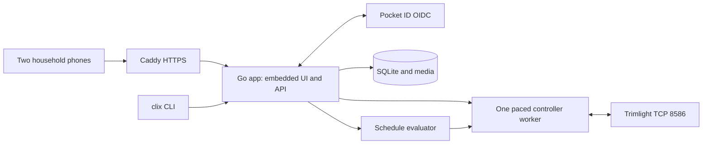

# Household lighting application

Living document. Rationale: [ADR-0003](../adr/0003-shared-homelab-application.md),
[ADR-0004](../adr/0004-pocket-id-and-truenas.md).
Pattern rationale: [ADR-0005](../adr/0005-versioned-household-patterns.md).
Calendar rationale: [ADR-0006](../adr/0006-explicit-calendar-intent.md).
Backup rationale: [ADR-0009](../adr/0009-consistent-portable-backups.md).
Backup contract: [backup and restore](../specs/backups.md).
Recovery procedure: [backup operations](backup-operations.md).
Photo rationale: [ADR-0008](../adr/0008-private-photos-and-physical-mapping.md).
Publication: [ADR-0007](../adr/0007-public-repository-and-private-deployment.md).
Contracts: [local service](../specs/local-service.md),
[household authentication](../specs/household-auth.md),
[house mapping](../specs/house.md), [pattern library](../specs/patterns.md), [calendar](../specs/schedules.md),
[draft v1 acceptance](../specs/v1-acceptance.md).

## Overview

Current: the clix CLI can read this controller's patterns and schedules. It has a
bounded write experiment, protocol fixtures, simulated-controller tests and a
container recipe. A loopback service persists observations and operation history
in SQLite, serializes explicit refresh requests, and requires a private API token.
Alternatively, household mode uses Pocket ID OIDC and serves the embedded React
UI. Initial screens show cached controller patterns, daily schedules and refresh
history. Authentication has simulated-provider coverage and confirmed desktop
Pocket ID sign-in and owner-confirmed phone passkey access. Second-user sign-in
and mobile task workflows remain open. The initial TrueNAS app and public Caddy HTTPS route
are deployed with controller access disabled; readiness, API authentication gates
and the OIDC redirect have passed integration checks.
Shared pattern editing, software strip previews, calendar editing and calendar
intent preview are implemented. House photo upload, manual mapping and software
previews are implemented under the house contract. Schedule execution, physical
calibration and verified hardware playback are not built.

The following is the accepted target, not a description of shipped components:

## Design

### Application boundaries

- `cmd/trimlight`: clix/Cobra command wiring only; flags are converted once into
  application configuration. Do not access clix's process-global flag variables
  inside concurrent HTTP handlers or workers.
- `internal/trimlight`: wire framing, typed controller models and capability checks.
- `internal/service`: bounded controller queue and authenticated HTTP API.
- `internal/storage`: SQLite schema and atomic observation/audit persistence. A
  process lock prevents concurrent owners of one data directory; separate data
  directories or hosts can still compete and require operational isolation.
- `internal/auth`: OIDC state/nonce/PKCE, subject allowlist, opaque sessions and CSRF.
- `internal/webui`: embedded browser build and restrictive content security policy.
- `internal/pattern`: validated design schema and deterministic logical-pixel render.
- `internal/schedule`: pure calendar validation, civil/solar intervals and precedence.
- `internal/house`: bounded photo normalization and validated address/geometry model.
  SQLite holds sanitized JPEG blobs and versioned layout references atomically.
- `web/`: compiled browser assets. Go embeds release assets; development may use
  a frontend dev server. No Node process is required in production.
- CLI commands proposed: `serve`, `status`, `doctor`, `patterns`, `schedules`,
  `layout`, `backup`, and `restore`. Keep the current snapshot/probe commands as
  explicit diagnostic operations during migration.

Implemented commands are `serve`, `status`, `refresh`, `snapshot` and
`probe-schedule2`. The service does not query hardware on startup or poll in the
background. Explicit refresh acknowledges possible clock synchronization and
uses a bounded queue, a 15-second operation deadline and one-second pacing between
operations. Failed reads preserve the last successful snapshot and record the
error. `status` reads cached storage only. Unverified hardware writes are disabled.
Bearer-token development mode is loopback-only. OIDC mode supports container
binding with a fixed external HTTPS origin. These modes cannot be combined.
The UI polls cached status every five seconds while visible; this does not poll
hardware. CLI status/refresh currently support only local bearer mode; household
CLI login remains to be implemented.

Use clix's reserved `--json`, `--verbose/-v`, `--dry-run/-n`, and `--silent/-s`
without redefining them. `--dry-run` must not call the current snapshot request,
because that request can synchronize the controller clock. Use cached state for
planning, report its age, and refuse operations requiring an unavailable baseline.
Emit one documented JSON result for ordinary commands; do not mix reporter JSON
events into that result. Controller operations currently use persisted audit
records; structured operational logging remains to be added.

The worker serializes whole operations, retains the validated pauses, bounds
timeouts/retries and verifies resulting state. An ambiguous write triggers a
read/reconcile step, not an automatic duplicate write. Browser updates use SSE or
equivalent events; two browsers never open controller sockets. Duplicate service
instances must be prevented operationally and detected where possible.

### Household state and authentication

Use one household, initially two allowed Pocket ID subjects. Both can operate
lights, edit patterns/schedules and upload photos. Administrative functions include
controller topology, identity membership, backup/restore and deployment settings.

The Go backend is a confidential OIDC client, with exact callback registration,
state/nonce validation, PKCE, and secure HttpOnly session cookies. Mutations require
CSRF protection and authorization. Use version checks on edited objects so one
phone cannot silently overwrite the other. Audit human actions by stable subject
and scheduler actions by rule ID. The scheduler does not depend on a user login
session or an available identity provider after startup.

Deployment target: a custom TrueNAS app behind an existing Caddy proxy and
Pocket ID. Actual host addresses, HTTPS domains, OIDC client and allowed subjects
live in ignored private configuration. Public examples use placeholder domains
and environment variables. LAN/VPN access remains the assumption; public app
exposure is not decided. Authentication uses the configured origin and exact Host, ignoring
forwarded headers. The container must reach Pocket ID and the controller.
OIDC discovery currently occurs at startup: Pocket ID must be reachable then.
Existing sessions do not call the provider on each request. App logout and expiry
work; provider back-channel logout is not implemented.

### Scheduling and control ownership

The implemented calendar is an immutable, versioned SQLite document with timezone,
optional location, weekly/seasonal/one-day rules and an optional expiring override.
Rules pin retained pattern revisions. A save is atomic with its reference index;
stale writes fail without overwriting a draft. Edits and archives in the pattern
library show current calendar references and explain pinned versions.

The pure Go evaluator resolves clock and solar boundaries, explicit overnight
windows and local start dates. Solar calculations run locally using pinned
`go-sunrise` v1.1.0; no coordinates are sent to an external service. IANA timezone
data is embedded for scratch deployment. Spring gaps shift forward by the gap;
repeated starts use the first instant, repeated ends the last. Missing solar events,
skipped civil dates and inverted windows generate visible issues.

Precedence is override > exception > seasonal > weekly > default off; numeric
priority breaks ties within each category. Equal-ranked different actions produce
a visible conflict and proposed off. The timeline names winning and shadowed rules.
The mobile calendar supports edits, history, draft downloads, conflict recovery,
solar settings, override expiry and local-date timeline previews. All-day rules
use midnight to next-day midnight. Previews are marked stale when the draft changes.

Execution remains disabled. Future runtime reconciliation will use this evaluator
at the current instant after restart/reconnect instead of replaying old events.
Persisted override expiry is already absolute; actual command delivery, execution
history and manual override/resume on hardware remain to be built and verified.

Before taking over, preserve native schedules and validate manual/off/timer mode
semantics. Native timers and the service must not compete. Unsupported native
entries must be surfaced during migration, never silently discarded. A phone-app
change is treated as external activity and surfaced; the service should yield or
pause for reconciliation rather than immediately fighting it.

Offline UI can show cached plans and photo previews. It must show stale controller
state and must not queue physical actions that unexpectedly execute hours later.

### Pattern library and photo mapping

Current pattern implementation uses stable random IDs and immutable SQLite
revisions, with version-checked edits, archive/restore and per-revision actor/time.
The browser polls the shared library while visible and retains a draft on conflict.
The editor supports names, favorites, color runs, brightness, reverse, static and
chase software preview, duplicate, JSON import/export and revision history.
Captured native patterns import atomically from the cached snapshot, retaining raw
parameters and capture time. Reimport skips previously imported slots. Their
palette controls and previews remain unavailable until decoding is verified.
Go and TypeScript render the same shared golden logical-pixel vectors; hardware
playback is still disabled. Scheduling pins retained revisions and shows reference impacts before changes.
Photos are not implemented yet.

Use stable application scene IDs and preserve controller IDs separately. Editing
a scene referenced by a schedule creates a revision with explicit impact. Support
names, favorites, duplicate/edit, import/export, brightness/speed/direction, palette
runs and validated effects. Keep controller slot limits separate from the larger
application library; never evict a scheduled scene silently.

A physical layout stores controller/output, logical bulb address, run order,
direction and known mirrored outputs. A photo view maps those same physical IDs to
normalized image coordinates. Multiple photos can show the same bulbs without
creating duplicate hardware addresses.

The mapping flow is: upload photo, draw roofline polylines, assign an output and
address range/count, choose direction, distribute bulbs along the line, and adjust
individual positions. Include gaps, disconnected segments, zoom/pan, undo/redo,
large touch handles, and a numbered overlay. Perspective makes automatic equal
spacing approximate; allow manual correction or subdivision. Show mapping status
until hardware addresses are calibrated with a short, low-brightness identify
action that restores the previous scene.

Store image dimensions, orientation and normalized coordinates independently of
screen size. Normalize iPhone orientation and HEIC input locally with a vetted
conversion path; support JPEG/PNG/WebP. Bound dimensions/size and remove location
metadata. Photos stay on the homelab and in its backups.

Canvas renders colored points and optional glow over the photo. Local preview does
not send controller commands. Editing, preview and controller compilation share a
versioned pattern schema and golden output vectors. Static colors and validated
motions should agree at the logical-pixel level. Proprietary firmware effects may
only have representative previews; label their fidelity instead of claiming exact
simulation. No 3D model or automatic roofline detection is required for v1.

## Operational notes

Deploy one non-root OCI container on a chosen Docker/Podman host (or an Incus guest
running it), behind the existing Caddy VM. Use local persistent storage for SQLite;
TrueNAS is a backup destination unless the selected deployment validates its local
dataset semantics. Do not place a live SQLite WAL database on a generic network
share. Export transactionally consistent database backups (including sanitized photo blobs)
plus required private configuration
and manifests; exercise restoration on an isolated instance with hardware disabled.

Provide separate process health and controller connectivity, structured logs,
operation history, last successful read/write, queue status and stale-state age.
Back up before database migrations; use versioned images and a documented rollback
path. Credentials stay outside the image/repository. The initial release needs no
Kubernetes, Redis, message broker or separate database server.

Server loss can leave the last lighting state active. Controller-native fallback
is a separate capability to validate, not a hidden assumption. Keep a documented
way to return control to the manufacturer app and restore saved native schedules.

## References

- Rationale: [ADR-0003](../adr/0003-shared-homelab-application.md).
- Contracts: [v1 acceptance](../specs/v1-acceptance.md).
- Built in: [roadmap Phases 1–6](../plans/roadmap.md).
- Current evidence: [protocol observations](../../protocol-observations.json),
  [current implementation guide](../../README.md).

The owner selected public source repository `bketelsen/trimlights` and GHCR images.
Compose consumes controller and deployment addresses from variables. Public wire
fixtures are synthetic throughout; private captures are preserved outside Git.
A probe requires a reviewed non-clock SHA-256 fingerprint before any edit command.
The image workflow checks the app before publishing amd64 and arm64 binaries.
